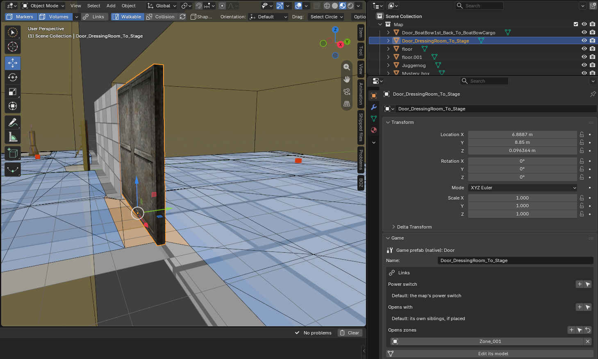
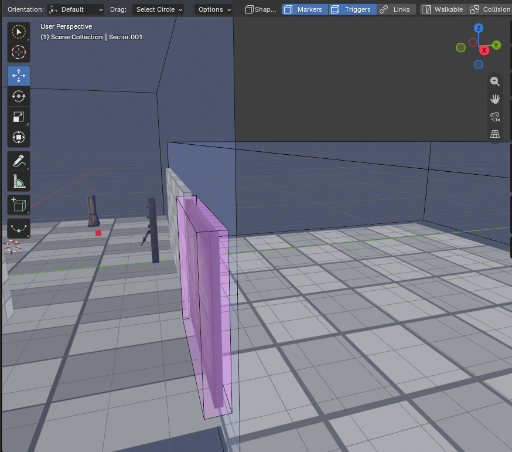

# How a map works

This page is the whole model on one page. Read it once and the rest of the docs will make sense.

## Three things you place

Everything in a map is one of three things:

| You place | What it is | Example |
| --- | --- | --- |
| **Model** | Something you can see | A wall, a floor, a statue |
| **Volume** | An invisible box that notices things, or marks part of the map | A **Trigger** (walked into), a **Hit** (shot), a **Use** (the player presses use), a [Zone](#zones) or a [Sector](#sectors) |
| **Prefab** | A group of models and volumes that act as one object, with an optional script | A skull you can shoot, a perk machine, a door |

```text
Vault  (a prefab, with a script)
├── Door      a model
├── Frame     a model
└── Keypad    a Use volume
```

The game's own objects (perk machines, doors, the mystery box) are prefabs too. You drag them in,
they work straight away, and you can change them from a script. See
[Game prefabs](game-prefabs.md).

## What an object does in the game

Every model and prefab has three switches in the editor's **In the game** box:

| Switch | What it means | From a script |
| --- | --- | --- |
| **Visible** | The master switch. A hidden object can't be seen, stops nothing and blocks nothing. | `object:hide()`, `object:show()` |
| **Walking** | **Walk on it** (it is floor), **Blocks** (nobody can walk through it) or **Walk through** (it doesn't matter to walking). | `object:set_blocks_walking(true)` |
| **Stops bullets** | Shots hit it and leave a mark, or pass through. | `object:set_stops_bullets(false)` |

The thing to remember: **players and zombies both walk on the walkable area, not on the models.**
The walkable area (the *navmesh*) is a map of where anyone can go, built from your floors and
walls when you build the map. Collision only decides what bullets hit.

So a wall needs both: **Blocks** to stop people, and **Stops bullets** to stop shots. A pane of
bulletproof glass you can walk through has only the second. A line nobody can cross but everyone
can shoot over has only the first.

The editor's **Show → Walkable** draws the walkable area, so you can see where people can go.

## New map or Remix

| Kind | You start with | Use it for |
| --- | --- | --- |
| **New map** | A floor, four player spawns and the Colt | Building your own level. This is the normal choice. |
| **Remix** (Kino der Toten, Ascension, Call of the Dead, Tutorial) | The whole original map | Changing a map that already exists |

What each kind gives you:

| | New map | Remix |
| --- | --- | --- |
| **Rooms** | Yours, built in the editor | The original map's, as they are |
| **The original objects** | | Moved, changed, hidden or removed |
| **Walkable area** | Built from your floors and walls | The original, rebuilt only near what you change |
| **[Zones](#zones)** | Yours: **Zone** volumes, opened by your doors | The original map's, opened by its own doors. Doors you place open none. |
| **[Sectors](#sectors)** | Yours: **Sector** and **Portal** volumes | The original map's rooms |
| **Rounds and zombie types** | From the map it's based on, changed in the [Game tab](editor.md#game-rules) | The original's, changed in the Game tab |
| **Prefabs, volumes and scripts** | Yes | The same |
| **Teleporters** | The **Teleporter** and **Wormhole** prefabs | The same |

Zone, Sector and Portal volumes are refused in a remix, because it keeps the original map's own.

## Names

An object's name in the editor is its name in scripts. A part of a prefab is `Prefab.Part`:

```lua
local boz = require("boz")

local vault = boz.get("Vault")            -- the prefab
local door = boz.get("Vault.Door")        -- one of its parts
```

`boz.get` gives you the object as its class, so a door has door methods and a perk machine has
perk methods. Copies you place get their own names, and a script runs once for each copy.

## Links

A link is one object pointing at another: this switch runs that trap, this perk needs that power
switch, this window belongs to that spawn. You make them in the **Links** box of the selected
object. The viewport draws them as lines (**Show → Links**).

Your own scripts can ask for links too, and read them with `self:links("name")`. See
[Links](prefabs.md#links).

## Zones

Zombies come out of the spawns near the players, but only from spawns in an **open zone**. A zone
is an area of the map. The players' starting room is open from the start, and buying a door opens
the rooms behind it, so zombies never come from rooms nobody has reached.

1. Drag a **Zone** from **Volumes** and scale it over a room. Its name is the zone's name.
2. Tick **Starting zone** on the zone where players start. A map has exactly one.
3. Cover every other room with a zone of its own.
4. Select each door, or Debris, and set **Opens zones** in its **Links** box to the zones behind it.



- A zombie spawn belongs to the zone it stands in. A spawn outside every zone belongs to the
  starting zone.
- A room that isn't box-shaped takes several Zone volumes with the same **Zone** name: together
  they are one zone. Left empty, a box is a zone of its own name.
- A door can open several zones, and several doors can open one zone: the first one bought opens
  it.
- **Active from the start** on a zombie spawn makes it work from the first round, whatever its
  zone.
- Zones draw nothing and block nobody: they only decide which spawns are used.
- The **Problems** panel warns about a zone no door opens, because its spawns would never wake.

A script can open and close zones, and hear players walk in. A lever that opens the cellar's
spawns early:

```lua
local Lever = boz.Prefab:extend("Lever")

---@link zone zone one "Zone it opens"

function Lever:on_use(player)
    local zone = self:links("zone")[1]
    if zone and zone:open() then
        player:message("Something stirs below")
    end
end

return Lever
```

See [Zones and sectors](scripting.md#zones-and-sectors) for everything a zone can do.

## Sectors

The game draws only the rooms the camera can see. Each room is a **sector**, and each doorway
between two rooms is a **portal**. Every frame the game draws the sector the camera is in, then
the sectors it can see through portals, and skips the rest. A big map stays fast this way: on Kino,
drawing every room costs about twice as much as drawing through portals.

1. Drag a **Sector** from **Volumes** and scale it over a room, floor to ceiling.
2. Do the same for every room. Sectors shouldn't overlap.
3. In each doorway between two sectors, drag a **Portal**, make it thin and scale it to fill the
   doorway. The build finds the sector on each side.



- Everything inside a sector is drawn with it: models, game prefabs, effects and zombies. There's
  nothing to link.
- A model belongs to the sector its middle is in. A floor or wall that runs through two rooms
  disappears whenever the room its middle is in isn't drawn, so split it per room.
- Anything outside every sector is always drawn when it's in view.
- A portal needs a sector on each side, reaching to just past its faces. Otherwise the build stops
  and says which side has none.
- An L-shaped room is two sectors, with a portal across the opening between them.
- Keep the camera inside a sector. Outside all of them, the game draws from the nearest one.
- With no sectors at all, everything is drawn, as in a map without them.

Most rooms get a Sector and a Zone. They can be the same size; the **Volumes** button's arrow hides
one kind while you work on the other.

To see the difference, `boz.sectors.set_culling(false)` in a script draws every room, and
`boz.get("Lobby"):drawn()` says whether a sector was drawn this frame. See
[Zones and sectors](scripting.md#zones-and-sectors).

## Two kinds of script

| | **Object script** | **Map script** |
| --- | --- | --- |
| Where | `scripts/prefabs/<Name>.lua`, attached to an object | `scripts/main.lua` |
| What it is | A class: what this object *is* and *does* | A list of things to listen for |
| Runs | Once for each object that has it | Once, when the game starts |
| Can it stop the object's behaviour? | Yes | No, it can only watch |

```lua
-- scripts/prefabs/Skull.lua: an object script, attached to a prefab
local Skull = boz.Prefab:extend("Skull")

function Skull:on_hit(player)
    self:hide()
    player:give_points(100)
end

return Skull
```

```lua
-- scripts/main.lua: the map script
local boz = require("boz")

boz.on("round_started", function(data)
    boz.player():message("Round " .. data.round)
end)

boz.get("Front_Door"):on("opened", function(door, player)
    player:give_points(500)
end)
```

Rule of thumb: if it is about **one object**, put it on the object. If it is about **the whole
match**, put it in `main.lua`.

## What Build & Run does

1. Saves your map and turns it into a mod, working out the walkable area, collision, zones and
   sectors.
2. Installs the mod in your client, last in the load order.
3. Starts the game and goes straight into your map.

If something would stop the build, the **Problems** panel tells you and selects the object.

Next: [Prefabs](prefabs.md), where you make your own.
